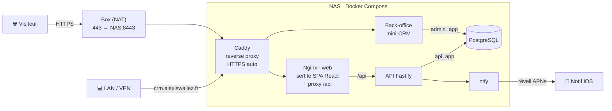

# Portfolio — Alexis Wallez

[](https://alexiswallez.fr)
[](https://react.dev)
[](https://www.typescriptlang.org)
[](https://docs.docker.com/compose/)
[](https://github.com/AWallez/portfolio/actions/workflows/ci.yml)

Portfolio full-stack de **développeur web freelance (React & DevOps)**, conçu, conteneurisé et **auto-hébergé** de bout en bout sur mon NAS. Le site est aussi une démo technique : le code de ce dépôt est ce qui tourne réellement en production sur **[alexiswallez.fr](https://alexiswallez.fr)**.

> Site vitrine React + TypeScript · API Node/Fastify + PostgreSQL pour le formulaire de contact · le tout conteneurisé (Docker) derrière un reverse proxy Caddy avec HTTPS automatique (Let's Encrypt).

## ✨ Points clés

- **Full-stack + infra** : front React, API Fastify, PostgreSQL, back-office (mini-CRM), notifications push (ntfy) et reverse proxy Caddy, orchestrés en **Docker Compose**
- **Bilingue FR/EN** et **thème clair/sombre**, esthétique terminal
- **Accessibilité (WCAG AA)** vérifiée, tests automatisés (Vitest + axe) et **CI GitHub Actions** sur les quatre parties du dépôt
- **Auto-hébergé** sur NAS domestique (Linux, Docker), HTTPS via Let's Encrypt
- **Déploiement avec retour arrière** : le script vérifie la configuration, attend que le nouveau conteneur soit sain et remet l'image précédente sinon

## 🏗️ Architecture



Le front et l'API sont servis **depuis la même origine** (Nginx proxy `/api` → conteneur `api`) → aucun CORS côté navigateur. Seul Caddy est exposé publiquement ; Postgres et l'API ne sont joignables que par le réseau Docker interne. Le back-office n'est servi qu'au réseau local et au VPN : ailleurs, Caddy répond 403.

Chaque service a son propre compte PostgreSQL : l'API peut seulement enregistrer un message et purger les anciens, le back-office lit et modifie les contacts. Le schéma et ces comptes sont créés par un service `migrate`, lancé avant les autres.

## 🧱 Stack

| Couche | Technologies |
| --- | --- |
| **Front** | React 19 · TypeScript · Vite 8 · Tailwind CSS v4 · i18n FR/EN |
| **Back** | Node.js · Fastify 5 · PostgreSQL (`pg`) · ntfy · Cloudflare Turnstile |
| **Back-office** | Fastify 5 · React 19 + Vite · sessions par cookie `__Host-` |
| **Infra** | Docker / Docker Compose · Nginx · Caddy (HTTPS Let's Encrypt, en-têtes de sécurité, CSP) · NAS Linux |
| **Qualité** | Vitest + Testing Library + axe · ESLint · GitHub Actions · shellcheck · Dependabot |

## 📁 Structure du dépôt

```
portfolio/
├── frontend/   SPA React + TypeScript (Vite, Tailwind)   → voir frontend/README.md
├── backend/    API de contact Fastify + PostgreSQL       → voir backend/README.md
├── admin/      back-office (mini-CRM) Fastify + React
├── infra/      Docker Compose, Caddy, scripts du NAS      → voir infra/README.md
└── .github/    CI et Dependabot
```

## 🚀 Démarrage rapide (dev local)

**Front** (sur `http://localhost:5173`) :

```bash
cd frontend
npm install
npm run dev
```

**API** (sur `http://localhost:3001`, nécessite un PostgreSQL + un topic ntfy) :

```bash
cd backend
npm install
cp .env.example .env    # remplir : Postgres + topic ntfy
npm run dev             # schéma : backend/db/ (service `migrate` de la pile Docker)
```

Détails dans [`frontend/README.md`](frontend/README.md) et [`backend/README.md`](backend/README.md).

## 📦 Déploiement

Toute la stack se déploie via **Docker Compose** depuis `infra/`, avec deux scripts :

- **`deploy.sh`** récupère le code et reconstruit les services demandés. Si le nouveau Caddyfile est invalide, il revient au commit précédent. L'image en service est gardée sous `:previous` : si le nouveau conteneur n'est pas sain sous deux minutes, il la remet en place.
- **`check-drift.sh`**, en cron toutes les 15 minutes, envoie une notification quand ce qui tourne sur le NAS n'est plus ce qu'il y a dans `main`. Il ne déploie rien : la mise en ligne reste manuelle.

Voir **[`infra/README.md`](infra/README.md)** pour la procédure complète (variables d'environnement, HTTPS, notifications, spécificités NAS).

## 🧪 Qualité & CI

À chaque push ou PR sur `main`, GitHub Actions lance quatre jobs :

| Job | Contrôles |
| --- | --- |
| **Front** | lint (ESLint), build (`tsc` + Vite), tests (Vitest, dont un contrôle d'accessibilité axe), `npm audit` |
| **API** | typecheck, tests, `npm audit` |
| **Back-office** | typecheck, build, `npm audit` |
| **Infra** | `docker compose config`, shellcheck, `caddy validate`, build des trois images |

Les actions sont épinglées par empreinte, et Dependabot propose les mises à jour une fois par mois.

## 🔒 Sécurité

- **En-têtes** : HSTS, CSP (les violations sont remontées à l'API), `X-Content-Type-Options`, `Referrer-Policy`, `Permissions-Policy`, `Cross-Origin-Opener-Policy`
- **Base de données** : un compte par service, avec les seuls droits dont il a besoin
- **Formulaire** : Cloudflare Turnstile et limite de 5 envois par minute ; les journaux ne gardent aucune adresse IP
- **Back-office** : réservé au réseau local et au VPN, mots de passe hachés (bcrypt), sessions révocables

---

*Développé par [Alexis Wallez](https://alexiswallez.fr) — développeur web freelance full-stack & DevOps.*
